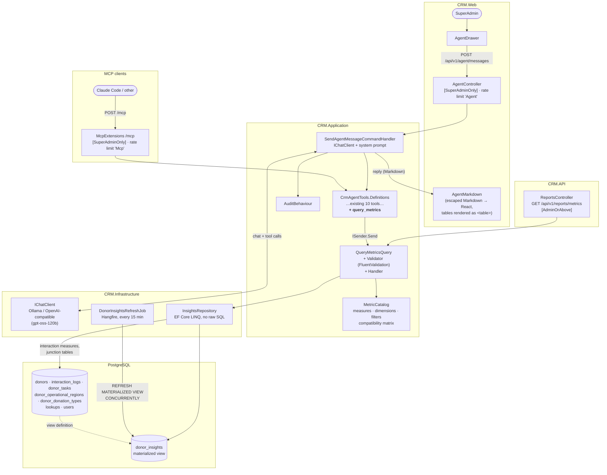
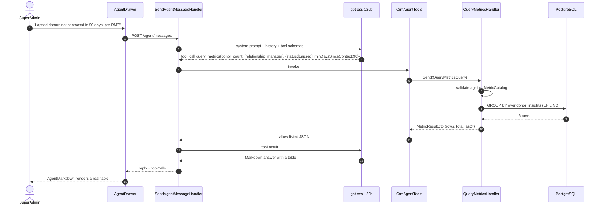
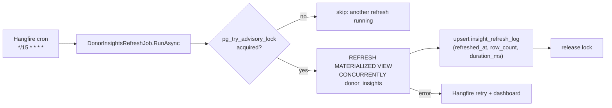

# Spec — Agent Metrics: `query_metrics` tool and `donor_insights` read model

| | |
|---|---|
| **Status** | Draft for team review |
| **Date** | 2026-10-20 |
| **Audience** | SA Harvest CRM dev team |
| **Users** | `SuperAdmin` (agent, MCP); `Admin` and up (REST endpoint) |
| **Extends** | `docs/agent-spec.md` (v1 agent) · `docs/mcp-spec.md` |
| **Related** | `.github/copilot-instructions.md` · `docs/risk-register.md` · `docs/security-review.md` |

---

## 1. Summary

The v1 agent answers analytical questions badly. Its tools return **rows**, 25
at a time, so a question like *"how many lapsed donors in KZN haven't been
contacted in 90 days, per relationship manager?"* makes the model page through
`search_donors` and count in its head. Open models (gpt-oss-120b today)
miscount, stop paging early or run out of tool iterations.

This spec adds two things:

1. **`donor_insights`**: a PostgreSQL materialized view with one PII-free row
   per donor holding precomputed facts (last contact, interaction counts, open
   and overdue tasks, and so on). A Hangfire job refreshes it.
2. **`query_metrics`**: one agent tool backed by a new MediatR query. The model
   picks a **measure**, up to two **group-by dimensions** and some **filters**,
   all from fixed lists. The database does the counting and the model gets back
   a small table of exact numbers.

Together they form a small **semantic layer**: named measures and dimensions
instead of SQL. The model never writes or sees SQL, and the allow-list for
what leaves the API is the view's column list.

---

## 2. Goals and non-goals

### Goals

- G1. Aggregate questions (counts, breakdowns, trends, "who hasn't been
  contacted") are answered with **one tool call** and **exact** numbers.
- G2. The model never sees or writes SQL. Every argument is an enum, id or date.
- G3. Data minimisation by construction: `donor_insights` holds no contact
  details, tax or registration numbers, addresses, free text, file names or URLs.
- G4. Same Clean Architecture and §4.2 authorization rule as `agent-spec.md`.
- G5. The answer always says how fresh the data is (`asOf`).
- G6. Works the same through the in-app agent and `/mcp`, because the tool is
  added to `CrmAgentTools.Definitions`.

### Non-goals

- Text-to-SQL or any free-form query language.
- RAG / pgvector over interaction notes (separate spec, after POPIA Q3).
- Charts in the agent drawer (tables only; see §9).
- Replacing the existing `/reports` screens or exports.
- Real-time numbers. Up to 15 minutes of staleness is acceptable (§5.3).

---

## 3. User stories and acceptance criteria

**US-1 — Breakdown question.**
*"How many active donors do we have per region?"*

- [ ] The agent makes exactly one `query_metrics` call (`measure=donor_count`, `groupBy=[region]`, `filters.status=[Active]`).
- [ ] The reply is a Markdown table with one row per region, and it matches `/reports` by-region for Active donors.

**US-2 — Two-dimensional question.**
*"Break down lapsed donors by relationship manager and company type."*

- [ ] One call with `groupBy=[relationship_manager, company_type]`; reply rendered as a table.

**US-3 — Recency question.**
*"Which RMs have the most donors not contacted in 90+ days?"*

- [ ] One call: `measure=donor_count`, `groupBy=[relationship_manager]`, `filters.minDaysSinceContact=90`.
- [ ] Donors that were never contacted are included and labelled.

**US-4 — Trend question.**
*"How many calls and meetings did we log per month this year?"*

- [ ] One call: `measure=interaction_count`, `groupBy=[month, interaction_type]`, `filters.interactionTypes=[Call, Meeting]`, `filters.from=2026-01-01`.

**US-5 — Invalid combination.**

- [ ] `groupBy=[interaction_type]` with `measure=donor_count` returns `{ error }` listing the valid dimensions for that measure. The model can recover and no exception reaches the user.

**US-6 — Freshness.**

- [ ] Every result carries `asOf` (SAST). If the view is older than 30 minutes, the result carries `stale: true` and the system prompt tells the model to mention it.

---

## 4. Architecture

### 4.1 End-to-end flow



### 4.2 A single question, step by step



### 4.3 Refresh pipeline



`CONCURRENTLY` keeps readers unblocked during a refresh. It needs the unique
index on `donor_id` (§5.2).

### 4.4 Layer placement

| Piece | Layer / path | Notes |
|---|---|---|
| `DonorInsight` (keyless read model) | CRM.Domain `ReadModels/DonorInsight.cs` | Plain class, no behaviour. Not a `BaseEntity`. |
| `MetricCatalog` (measures, dimensions, filters, compatibility) | CRM.Application `Modules/Insights/MetricCatalog.cs` | Single source of truth for the tool description, validator and handler. |
| `QueryMetricsQuery` / handler / validator | CRM.Application `Modules/Insights/Queries/QueryMetrics/` | Handler maps the request to `IInsightsRepository` calls. |
| `MetricResultDto`, `MetricRowDto` | CRM.Application `Modules/Insights/Dtos/` | |
| `IInsightsRepository` | CRM.Application `Common/Interfaces/` | `QueryDonorMetricAsync`, `QueryInteractionMetricAsync`, `GetLastRefreshAsync`. |
| `IDonorInsightsRefreshJob` | CRM.Application `Common/Interfaces/` | Same pattern as `ITaskDueNotificationJob`. |
| `InsightsRepository` | CRM.Infrastructure `Persistence/Repositories/` | EF Core LINQ only. |
| `DonorInsightConfiguration` | CRM.Infrastructure `Persistence/Configurations/` | `HasNoKey().ToView("donor_insights")`. |
| Migration `AddDonorInsightsView` | CRM.Infrastructure `Migrations/` | `migrationBuilder.Sql(...)` creates the view and indexes; `Down` drops them. |
| `DonorInsightsRefreshJob` | CRM.Infrastructure `Jobs/` | The only raw SQL: the `REFRESH` statement. |
| Job registration | CRM.API `Extensions/RecurringJobRegistration.cs` | `DonorInsightsRefreshJobId`, cron `*/15 * * * *`. |
| `GET /api/v1/reports/metrics` | CRM.API `ReportsController` | Thin. Needed for the §4.2 rule (§7.1). |
| `query_metrics` tool | CRM.Application `Modules/Agent/Tools/CrmAgentTools.cs` | Added to `Definitions`, so MCP gets it too. |

No new packages.

---

## 5. `donor_insights` read model

### 5.1 Columns

One row per donor. **Allow-list:** anything not listed here is not in the view.

| Column | Type | Source / rule |
|---|---|---|
| `donor_id` | uuid | `donors.id`. Unique index. |
| `status` | text | `DonorStatus` name. |
| `company_type` | text | `lookup_company_types.name` |
| `donation_frequency` | text | `lookup_donation_frequencies.name` |
| `bbbee_status` | text null | `lookup_bbbee_statuses.name` |
| `submission_source` | text | `SubmissionSource` name. |
| `relationship_manager_id` | uuid null | `donors.relationship_manager_id` |
| `created_at` | timestamptz | `donors.created_at` |
| `follow_up_date` | timestamptz null | `donors.follow_up_date` |
| `last_interaction_at` | timestamptz null | `max(interaction_logs.created_at)` |
| `last_interaction_type` | text null | Type of that latest interaction. |
| `interaction_count_total` | int | |
| `interaction_count_30d` / `_90d` / `_365d` | int | Rolling, relative to refresh time. |
| `open_task_count` | int | `donor_tasks` where `is_completed = false` |
| `overdue_task_count` | int | Open with `due_date < now()` at refresh time. |
| `next_task_due` | timestamptz null | `min(due_date)` of open tasks. |
| `active_document_count` | int | Count only. No names or types. |
| `refreshed_at` | timestamptz | `now()` at refresh. |

**Deliberately excluded:** company name (the agent already gets it from
`search_donors`/`get_donor`, and keeping it out of the view means a grouped
result can never list companies), contacts, phone/email, tax and registration
numbers, website, addresses, `operations_logistics_details`,
`additional_information`, interaction subjects/bodies, task titles, document
file names, submission tokens, marketing consent.

**Multi-valued dimensions** (region, donation type) are **not** flattened into
the view. The repository joins the existing `donor_operational_regions` and
`donor_donation_types` junction tables. This keeps one row per donor and avoids
array columns that EF can't group on cleanly.

**Date-relative values** such as "days since contact" and "follow-up overdue"
are computed **at query time** from `last_interaction_at` and `follow_up_date`,
so they are never stale. Only the rolling counts and `overdue_task_count`
depend on refresh time.

### 5.2 Migration (shape)

```sql
CREATE MATERIALIZED VIEW donor_insights AS
SELECT d.id AS donor_id, d.status, ct.name AS company_type, /* … §5.1 … */
       li.created_at AS last_interaction_at, li.interaction_type AS last_interaction_type,
       coalesce(ic.total, 0) AS interaction_count_total, /* … */
       now() AS refreshed_at
FROM donors d
JOIN lookup_company_types ct ON ct.id = d.company_type_id
/* … */
LEFT JOIN LATERAL (SELECT created_at, interaction_type FROM interaction_logs
                   WHERE donor_id = d.id ORDER BY created_at DESC LIMIT 1) li ON true
LEFT JOIN LATERAL (SELECT count(*) AS total,
                          count(*) FILTER (WHERE created_at >= now() - interval '30 days') AS d30
                          /* … */
                   FROM interaction_logs WHERE donor_id = d.id) ic ON true
/* … tasks, documents … */;

CREATE UNIQUE INDEX ux_donor_insights_donor_id ON donor_insights (donor_id);
CREATE INDEX ix_donor_insights_status ON donor_insights (status);
CREATE INDEX ix_donor_insights_rm ON donor_insights (relationship_manager_id);
```

Column and enum storage must match the existing EF conventions (check
`CrmDbContext` for snake_case naming and whether enums are stored as strings
or ints) before the SQL is finalised.

### 5.3 Freshness

- Refreshed every 15 minutes by Hangfire, and once at startup if
  `insight_refresh_log` is empty.
- `insight_refresh_log` is a one-row table (`refreshed_at`, `row_count`,
  `duration_ms`) so `asOf` doesn't need a `max()` over the view.
- `asOf` older than 30 minutes → `stale: true` in the result.
- Expected cost: well under a second for the current donor count. Revisit the
  interval if refresh time goes above 5 seconds.

---

## 6. `query_metrics` tool

### 6.1 Measures

| Measure | Source | Meaning |
|---|---|---|
| `donor_count` | `donor_insights` | Number of donors matching the filters. |
| `open_task_count` | `donor_insights` | Sum of open tasks. |
| `overdue_task_count` | `donor_insights` | Sum of overdue tasks (as of refresh). |
| `overdue_followup_count` | `donor_insights` | Donors with `follow_up_date < today (SAST)`. |
| `avg_days_since_contact` | `donor_insights` | Mean days since last interaction (never-contacted donors excluded and counted separately in `notes`). |
| `interaction_count` | `interaction_logs` (live) | Interactions logged in `[from, to]`. |
| `contacted_donor_count` | `interaction_logs` (live) | Distinct donors with ≥1 interaction in `[from, to]`. |

Interaction measures read the live table because periods are arbitrary. They
only select `donor_id`, `created_at`, `interaction_type` and
`created_by_user_id`, never `subject` or `body`.

### 6.2 Dimensions (`groupBy`, max 2)

| Dimension | Valid with | Label returned |
|---|---|---|
| `status` | donor measures | `Active`, `Lapsed`, … |
| `region` | all | Region code + name, e.g. `GP — Gauteng`. Multi-valued (§6.5). |
| `company_type` | all | Lookup name. |
| `donation_type` | all | Lookup name. Multi-valued (§6.5). |
| `donation_frequency` | all | Lookup name. |
| `bbbee_status` | donor measures | Lookup name, or `Not set`. |
| `relationship_manager` | all | User full name, or `Unassigned`. Donor RM, not the person who logged the interaction. |
| `logged_by` | interaction measures | Full name of the staff member who logged it. |
| `interaction_type` | interaction measures | `Note`, `Email`, `Call`, `Meeting`, `FormSubmission`, `FollowUp`. |
| `month` | interaction measures | `yyyy-MM`, SAST. |
| `contact_recency` | donor measures | `0–30 days`, `31–90 days`, `91–180 days`, `180+ days`, `Never contacted`. |

`MetricCatalog` holds this matrix. The validator rejects invalid pairs with a
message listing the valid dimensions.

### 6.3 Filters (all optional, combined with AND)

| Filter | Type | Applies to |
|---|---|---|
| `statuses` | `DonorStatus[]` | all |
| `regionCodes` | `string[]` | all |
| `companyTypes` | `string[]` | all |
| `donationTypes` | `string[]` | all |
| `relationshipManagerId` | `Guid` | all |
| `bbbeeStatuses` | `string[]` | donor measures |
| `minDaysSinceContact` / `maxDaysSinceContact` | `int` 0–3650 | donor measures. `min` includes never-contacted donors. |
| `followUpOverdue` | `bool` | donor measures |
| `interactionTypes` | `InteractionType[]` | interaction measures |
| `from` / `to` | `yyyy-MM-dd` (SAST) | interaction measures; required for them, default last 30 days; max span 3 years. |

Lookup values are matched case-insensitively against the lookup tables. Unknown
values return `{ error }` listing the valid ones.

### 6.4 Tool signature (as the model sees it)

```csharp
[Description("""
    Count and group CRM data in one call. Use this for ANY question about how many, totals,
    breakdowns, trends or rankings. Do not page through search_donors to count.
    measure: donor_count | open_task_count | overdue_task_count | overdue_followup_count |
             avg_days_since_contact | interaction_count | contacted_donor_count.
    groupBy: up to 2 of status, region, company_type, donation_type, donation_frequency,
             bbbee_status, relationship_manager, logged_by, interaction_type, month, contact_recency.
    interaction_count and contacted_donor_count need from/to (yyyy-MM-dd).
    Returns rows sorted by value (desc), at most 50, plus total and asOf.
    """)]
public Task<object> QueryMetricsAsync(
    string measure,
    string[]? groupBy = null,
    string[]? statuses = null,
    string[]? regionCodes = null,
    string[]? companyTypes = null,
    string[]? donationTypes = null,
    Guid? relationshipManagerId = null,
    string[]? bbbeeStatuses = null,
    int? minDaysSinceContact = null,
    int? maxDaysSinceContact = null,
    bool? followUpOverdue = null,
    string[]? interactionTypes = null,
    DateOnly? from = null,
    DateOnly? to = null,
    CancellationToken cancellationToken = default)
```

Filters are flat parameters, not a nested object, because small models fill
flat schemas more reliably. The enum lists in the description are generated
from `MetricCatalog` so they can't drift.

### 6.5 Result shape

```json
{
  "measure": "donor_count",
  "groupBy": ["relationship_manager"],
  "filters": { "statuses": ["Lapsed"], "minDaysSinceContact": 90 },
  "rows": [
    { "group": { "relationship_manager": "Thandi Nkosi" }, "value": 7 },
    { "group": { "relationship_manager": "Unassigned" }, "value": 3 }
  ],
  "total": 10,
  "truncated": false,
  "asOf": "2026-10-20T14:15:00+02:00",
  "stale": false,
  "notes": []
}
```

- `filters` echoes the **normalised** filters (defaults applied), so the model
  can state exactly what was counted.
- `total` is the measure **without** grouping. For multi-valued dimensions
  (`region`, `donation_type`) a donor in two regions is counted in both rows,
  so the rows can add up to more than `total`. In that case `notes` says
  *"Donors can belong to several regions; rows overlap."*
- Max 50 rows, sorted by value descending. If there are more, `truncated: true`
  and an extra `{ "group": "Other", "value": n }` row.
- `avg_days_since_contact` values are rounded to 1 decimal.
- Never contains donor ids or company names. To list the donors behind a number,
  the model follows up with `search_donors` using the same filters (system prompt rule, §8).

### 6.6 Validation (`QueryMetricsQueryValidator`)

- `measure` is in the catalog.
- `groupBy` has 0–2 distinct entries, each valid for the measure.
- Filters are valid for the measure. A donor-only filter on an interaction measure is an error, not silently ignored.
- `min ≤ max` days; `from ≤ to`; span ≤ 3 years; `to` not in the future.
- Array filters have ≤ 20 values each.

A `ValidationException` inside the tool is returned to the model as
`{ "error": "…" }` by the existing `RunAsync` wrapper.

---

## 7. API and authorization

### 7.1 `GET /api/v1/reports/metrics`

`agent-spec.md` §4.2 only lets a tool wrap a query whose controller endpoint
includes `SuperAdmin`. `query_metrics` gets a REST endpoint on
`ReportsController` (`AdminOrAbove`, the same as the other reports). That also
gives the Reports screen a future "custom breakdown" feature for free.

- Query-string binding of the §6 arguments (`groupBy=region&groupBy=status`).
- Thin: map → `Send` → `Ok`.
- Response: the §6.5 shape inside the standard envelope.

### 7.2 Audit

- Agent and MCP calls are already audited (`SendAgentMessageCommand`,
  `RecordMcpToolCallCommand`). Tool arguments are recorded, results are not.
- `QueryMetricsQuery` is a query, so it is not audited on the REST path either,
  the same as the other report endpoints.

---

## 8. System prompt changes

Add to `AgentSystemPrompt` rules:

```
7. For any count, total, breakdown, trend or ranking, call query_metrics once.
   Never count by paging through search_donors.
8. Present query_metrics results as a Markdown table with a header row, then one
   sentence of interpretation. State the filters you used and the asOf time.
   If stale is true, say the figures may be up to an hour old.
9. To name the donors behind a number, call search_donors with matching filters.
```

---

## 9. Frontend: tables in agent replies

The agent drawer already renders Markdown tables through `AgentMarkdown`
(`agent-spec.md` §10.2). gpt-oss-120b output often missed the strict parser
and showed as raw `| … |` lines. This spec updates `AgentMarkdown` to:

- accept header/body rows **without** leading or trailing pipes, as long as a divider row follows the header;
- accept divider rows with one or more dashes, alignment colons, and Unicode dashes (`‐ ‑ – — −`) that gpt-oss uses;
- honour column alignment from the divider (`:---`, `:---:`, `---:`), and right-align numeric columns by default;
- treat `<br>` inside a cell as a line break (rendered as a React `<br />`, never as HTML);
- handle escaped pipes `\|` inside cells;
- pad or trim ragged rows to the header width;
- draw a bordered table with a tinted header row and zebra striping, scrolling horizontally inside the bubble;
- let assistant bubbles that contain a table use the full drawer width.

All text still becomes escaped React text nodes. No `dangerouslySetInnerHTML`,
no new dependency.

---

## 10. Security and POPIA

| Risk | Mitigation |
|---|---|
| Personal data in aggregates | The view's column list is the allow-list (§5.1). No names of donors or contacts. Staff names appear only as `relationship_manager` / `logged_by` labels, which `get_manager_activity` already exposes. |
| Re-identification through small groups | Donors are companies, not data subjects, so group sizes of 1 are acceptable. Revisit if individual (sole-proprietor) donors are added. |
| Expensive queries / DoS | Max 2 dimensions, 50 rows, 3-year span, ≤20 filter values; indexed view; existing per-user rate limits. |
| SQL injection | No SQL is built from input. Arguments map to enum-keyed LINQ expressions in the repository. |
| Stale data presented as current | `asOf` + `stale` on every result; prompt rule 8. |
| Free text leaking through interaction measures | Repository projections select ids, dates and types only (test in §11). |

**Docs to update in the same PR:** `risk-register.md` (stale analytics),
`security-review.md` (new endpoint), `DEVELOPER_GUIDE.md` (refreshing the view
locally: `REFRESH MATERIALIZED VIEW donor_insights;`), and `agent-spec.md` §6
(tool #11) and §13 (mark item done).

---

## 11. Testing

**`tests/CRM.Application.Tests/Modules/Insights/`**

- `QueryMetricsQueryValidatorTests`: every rule in §6.6, including each invalid measure/dimension pair from the matrix.
- `QueryMetricsQueryHandlerTests` (mocked `IInsightsRepository`): `Other` row and `truncated`, `stale` threshold, overlap note for multi-valued dimensions, normalised filter echo, SAST date handling.
- `MetricCatalogTests`: the tool description lists every catalog value (drift test, same idea as the MCP tool-definition drift test).

**`tests/CRM.Infrastructure.Tests/` (Testcontainers PostgreSQL, or the existing integration setup)**

- Migration creates the view; `REFRESH … CONCURRENTLY` succeeds.
- Each measure × one dimension against seeded data equals a hand-computed expectation.
- `by_status`, `by_region` and `by_type` from `query_metrics` equal the existing report queries (consistency check).
- Interaction-measure SQL (via `ToQueryString()`) never selects `subject` or `body`.

**`tests/CRM.Application.Tests/Modules/Agent/CrmAgentToolsTests`**

- `query_metrics` sends the right query; `ValidationException` → `{ error }`.
- Redaction test extended: output never contains phone, email, tax number, `http`, or a donor company name.

**`tests/CRM.API.Tests/`**

- `/api/v1/reports/metrics`: 401, 403 for Procurement/Marketing, 200 for Admin/SuperAdmin, 400 envelope on invalid combos.
- Recurring job registration includes `DonorInsightsRefreshJobId`.

**Frontend (Vitest)** — `AgentMarkdown.test.tsx`: pipe-less rows, single-dash and Unicode-dash dividers, alignment, `<br>` in cells, escaped pipes, ragged rows, and that a `<br>` or `<script>` in a cell never becomes an element other than the React `<br />`.

**Manual eval:** add 6 aggregate questions to the reference set in
`agent-spec.md` §12 (US-1…US-4 plus "overdue follow-ups by region" and "donors
contacted last month per RM"). Pass = one `query_metrics` call, correct numbers,
rendered as a table.

---

## 12. Open questions

| # | Question | Proposed answer | Owner |
|---|---|---|---|
| M1 | Materialized view or a real table rebuilt by the job? | Materialized view: one SQL definition, `CONCURRENTLY` keeps reads unblocked, nothing to keep in sync. Switch to a table only if we need incremental updates. | Dev team |
| M2 | 15-minute refresh enough? | Yes for a CRM with this volume. Optionally also refresh after the public-form submission and approval commands. | Dev team |
| M3 | Should `search_donors` gain `minDaysSinceContact` so the "list the donors" follow-up matches exactly? | Yes; small change to `GetDonorsQuery` (could read `donor_insights`). | Dev team |
| M4 | Expose `query_metrics` on the Reports screen? | Later; the endpoint exists after this spec. | SA Harvest |

---

## 13. Delivery plan (suggested issues)

1. **Read model**: `DonorInsight`, configuration, migration, `insight_refresh_log`, refresh job + registration, integration tests.
2. **Query**: `MetricCatalog`, `QueryMetricsQuery` + validator + handler, `IInsightsRepository` + implementation, unit and integration tests.
3. **Endpoint + tool**: `GET /api/v1/reports/metrics`, `query_metrics` in `CrmAgentTools.Definitions`, system prompt rules 7–9, tool tests.
4. **Frontend**: `AgentMarkdown` table hardening and styling (§9). Independent of 1–3.
5. **Docs + eval**: §10 doc updates, extended eval questions, run against gpt-oss-120b.

Issues 1 and 4 can start in parallel; 2 depends on 1; 3 depends on 2.
